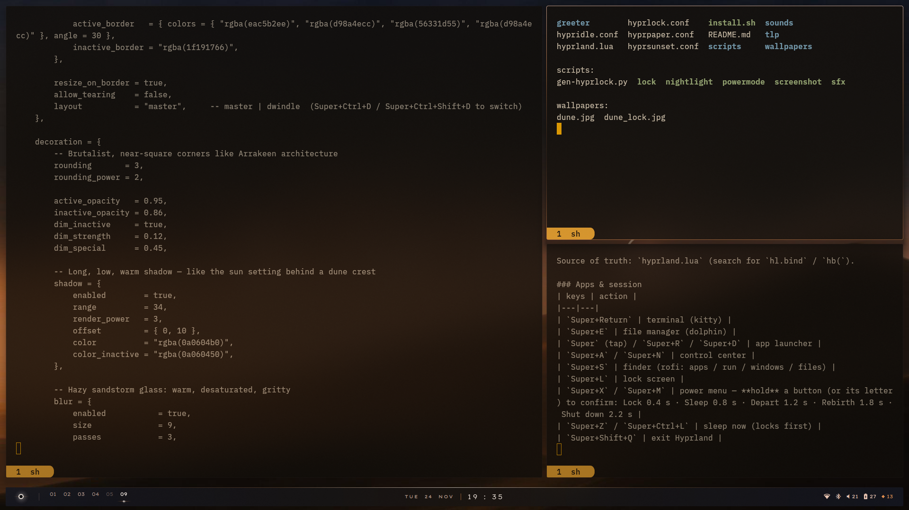
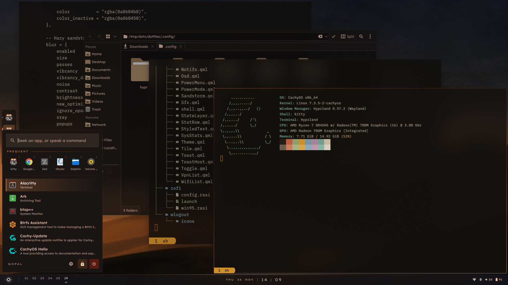
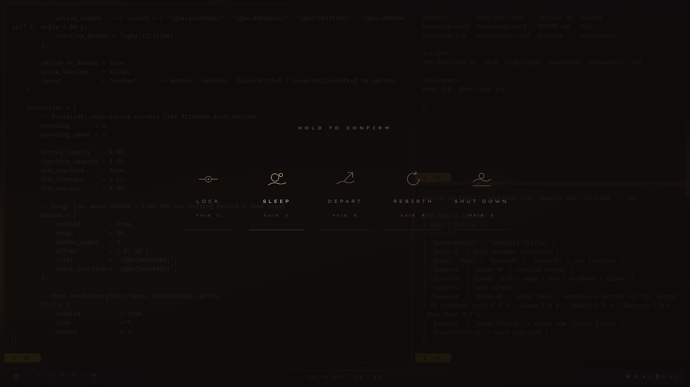
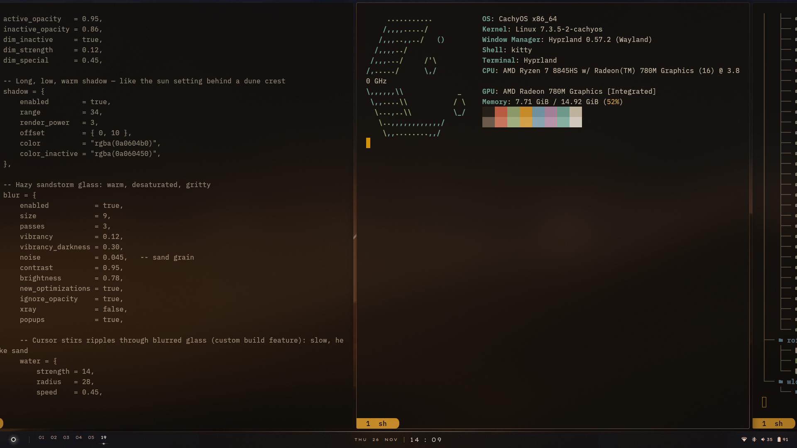

# DUNE — Arrakis at dusk

A Hyprland + Quickshell desktop themed after *Dune*: thin, wide-tracked type, near-square shapes,
a dusk-navy and spice-sand palette, a slowly rotating "eclipse flare" border, slow heavy motion
and procedurally synthesised sound effects.



> [!WARNING]
> **Parts of this configuration were written by an AI assistant (Claude).** It has only been used
> on one machine and has not been reviewed line by line — read it before you install it.
> It targets **Hyprland 0.57+** (the Lua config format; `hyprland.lua`, not `hyprland.conf`) and is
> tuned for one laptop (monitor names, VRR, TLP). Expect to adjust things.

| Launcher | Power menu (hold to confirm) |
|---|---|
|  |  |



## What's in it
- **Hyprland** (`.config/hypr/hyprland.lua`) — rotating flare border, near-square corners, long warm
  shadows, gritty sand-haze blur, and slow "sandSettle / haze / wind" animation curves.
  Three layouts — **master**, **dwindle**, **scrolling** — cycled with `Hyper+Tab`, with a toast on switch.
  A **Hyper key** layer on Caps Lock; floating-only workspaces; scratchpad.
- **Quickshell UI** (`.config/quickshell`) — bar, launcher that learns your frequent apps, control center
  (Wi-Fi, Bluetooth, VPN, power mode, volume/brightness, media), notification toasts, OSD, drifting
  sand and a login title card. Colours live in `colors.json`.
- **hyprlock / hypridle / hyprpaper / hyprsunset** — cinematic lock screen generated by
  `scripts/gen-hyprlock.py`, staged idle (dim → lock → screen off → suspend), night light.
- **Sound** — `sounds/gen.py` synthesises the horn (login), thumper (lock), wind (unlock) and friends.
- **Power** — `scripts/powermode` follows the charger (blur, shadows and refresh rate drop on battery);
  optional TLP profile in `tlp/` (HP Pavilion Plus 14, Ryzen 7 8845HS — change it for your hardware).
- **kitty, rofi, wlogout icons**, and the Lexend / Michroma fonts (SIL OFL).

### Palette
| role | hex |
|---|---|
| night sky | `#161924` |
| charcoal / deep | `#1a1513` / `#0d0b0a` |
| spice (accent) | `#d98a4e` |
| sand | `#a96033` |
| pale sand (text) | `#eac5b2` |
| flare | `#fff4ec` |
| eyes of Ibad (rare highlight) | `#8ec9ff` |

## Install
Arch / CachyOS. Read the warning above first.

```sh
git clone https://github.com/bropal404/dotfiles.git
cd dotfiles
./install.sh --dry-run     # see what it would do
./install.sh               # install packages, copy configs, fonts
```

Options: `--yes`, `--dry-run`, `--no-packages`, `--tlp` (laptop-specific power tuning),
`--greeter` (greetd login screen — edits `/etc/greetd/config.toml`).
Existing `~/.config/{hypr,quickshell,kitty,rofi,wlogout}` are moved to `*.bak-<timestamp>`.
Afterwards check `hyprctl configerrors` and `hyprctl deprecated-config`.

Hard-coded `/home/gopal` paths are rewritten to your home directory by the installer.
If you copy files by hand, search for that string.

## Layout
```
.config/hypr         hyprland.lua, hyprlock/hypridle/hyprpaper/hyprsunset, scripts/, sounds/, wallpapers/, tlp/, greeter/
.config/quickshell   the Dune shell
.config/kitty        terminal
.config/rofi         finder (Super+S)
.config/wlogout      icons used by the power menu
.local/share/fonts   Lexend, Lexend Zetta, Lexend Peta, Michroma
install.sh
```

## Keybindings
`Super` = the Windows key. **Hyper** = Caps Lock (`caps:hyper`, Mod3); press both Shifts for real Caps Lock.
Source of truth: `.config/hypr/hyprland.lua` (search for `hl.bind` / `hb(`).

### Apps & session
| keys | action |
|---|---|
| `Super+Return` | terminal (kitty) |
| `Super+E` | file manager (dolphin) |
| `Super` (tap) / `Super+R` / `Super+D` | app launcher |
| `Super+A` / `Super+N` | control center |
| `Super+S` | finder (rofi: apps / run / windows / files) |
| `Super+L` | lock screen |
| `Super+X` / `Super+M` | power menu — **hold** a button (or its letter) to confirm: Lock 0.4 s · Sleep 0.8 s · Depart 1.2 s · Rebirth 1.8 s · Shut down 2.2 s |
| `Super+Z` / `Super+Ctrl+L` | sleep now (locks first) |
| `Super+Shift+Q` | exit Hyprland |
| `Print` / `Super+Shift+S` | screenshot: area |
| `Shift+Print` / `Ctrl+Print` | screenshot: full screen / area + edit |
| `Hyper+Enter` / `Hyper+Space` | terminal / launcher on a fresh empty workspace |

### Windows
| keys | action |
|---|---|
| `Super+Q` | close window |
| `Super+V` | toggle floating |
| `Super+F` | fullscreen |
| `Super+P` | pseudo-tile |
| `Super+J` | toggle split (dwindle) |
| `Super+Y` / `Super+Shift+P` / `Hyper+Y` | pin window to all workspaces (floats it first) |
| `Super+Shift+V` / `B` / `N` | float and size window to 900×500 / 1200×700 / 1600×900 |
| `Super+Space` | toggle current workspace between tiling and **floating-only** |
| `Super+Arrows` | focus left / right / up / down |
| `Super+Ctrl+Arrows` / `Hyper+Arrows` | move window in that direction |
| `Super+Ctrl+Shift+Arrows` / `H J K L` | resize window by 30 px |
| `Super+Ctrl+R` | resize mode (arrows / `H J K L`, `Esc` or `Enter` to leave) |
| `Super+Left-drag` / `Super+Right-drag` | move / resize with the mouse |
| `Super+Shift+Left-drag` | resize with the mouse |
| `Super+T` / `Hyper+T` | toggle tab group |
| `Super+Alt+←` / `→` | previous / next tab in group |
| `Super+G` / `Super+Shift+G` / `Super+Ctrl+G` | gaps: none / small (3·5) / medium (5·10) |

### Layouts
Layout is global. Switching shows a toast.

| keys | action |
|---|---|
| `Hyper+Tab` | cycle master → dwindle → scrolling |
| `Super+Ctrl+D` / `Super+Ctrl+Shift+D` | dwindle / master |
| `Super+Ctrl+S` | scrolling |

**Master**

| keys | action |
|---|---|
| `Hyper+D` | swap focused window with the master |
| `Hyper+F` / `Hyper+Shift+F` | roll through the stack, next / previous |
| `Hyper+A` | focus the master |
| `Hyper+S` / `Hyper+Shift+S` | cycle focus through the windows, next / previous |
| `Super+\` / `Super+Ctrl+\` | next / previous orientation |
| `Super+Shift+\` | master width back to 50% |
| `Super+]` / `Super+[` | master width +5% / −5% |
| `Super+Shift+]` / `Super+Shift+[` | add / remove a master |

**Scrolling**

| keys | action |
|---|---|
| `Hyper+=` / `Hyper+-` | column wider / narrower |
| `Hyper+B` | cycle column width (1/3 · 1/2 · 2/3 · full) |
| `Hyper+V` | fit visible columns |
| `Hyper+U` | pull window into its own column |
| `Super+Shift+Wheel` | step column by column |
| 4-finger swipe left / right | drag the strip |

### Workspaces & monitors
Workspaces 1–10 are dynamic (not tied to a monitor or app).

| keys | action |
|---|---|
| `Super+1…0` | go to workspace 1–10 |
| `Super+Shift+1…0` | move window to workspace 1–10 |
| `Hyper+1…0` | move window to workspace 1–10 |
| `Super+Wheel` | next / previous workspace |
| `Super+.` / `Super+,` | next / previous workspace on this monitor |
| `Mouse side buttons` | next / previous workspace on this monitor |
| `Super+Tab` | previous workspace |
| `Super+Ctrl+\`` | first empty workspace |
| `Super+Ctrl+]` / `[` | move window to next / previous workspace |
| `Hyper+]` / `[` | same, carrying the window |
| `Super+Ctrl+.` / `Hyper+\` | move window to an empty workspace |
| `Super+\`` / `Super+Shift+\`` | toggle scratchpad / send window to it |
| `Super+Alt+↑` / `↓` | focus monitor above / below |
| `Super+Alt+Tab` | focus next monitor |
| `Super+Shift+Ctrl+↑` / `↓` | move window to monitor above / below |
| `Super+Shift+↑` / `↓` / `Hyper+Shift+↑` / `↓` | send workspace to monitor above / below |
| `Super+Shift+M` | send workspace to next monitor |
| `Super+Alt+S` | swap workspaces between the two monitors |
| 3-finger swipe left / right | switch workspace |
| 4-finger swipe up / down | send workspace to monitor above / below |

### Media & brightness
| keys | action |
|---|---|
| `Volume Up` / `Down` / `Mute` | volume (with toast) |
| `Mic Mute` | toggle microphone |
| `Brightness Up` / `Down` | laptop brightness (with toast) |
| `Super+Brightness Up` / `Down` | external monitor brightness (ddcutil) |
| `Play` / `Pause` / `Next` / `Prev` | media control |

### Dune extras (Hyper)
| keys | action |
|---|---|
| `Hyper+W` / `Hyper+G` | toggle drifting sand / summon a gust |
| `Hyper+I` | replay the title card |
| `Hyper+M` | mute / unmute sound effects |
| `Hyper+O` / `Hyper+P` | animations off / on |
| `Hyper+L` | toggle auto-lock (hypridle) |
| `Hyper+N` | toggle night light |
| `Hyper+C` | colour picker (hex to clipboard) |
| `Hyper+E` | find cursor (pulse rings) |
